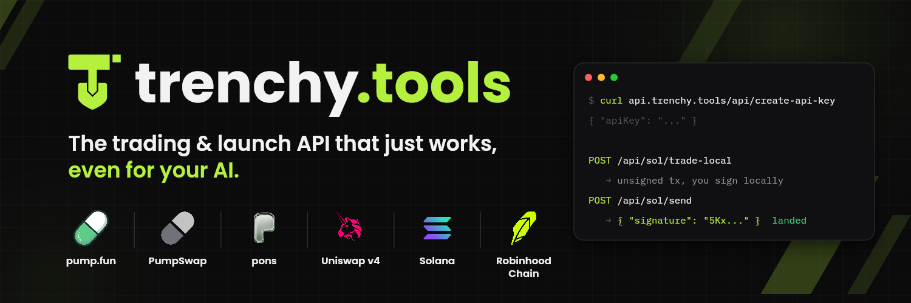
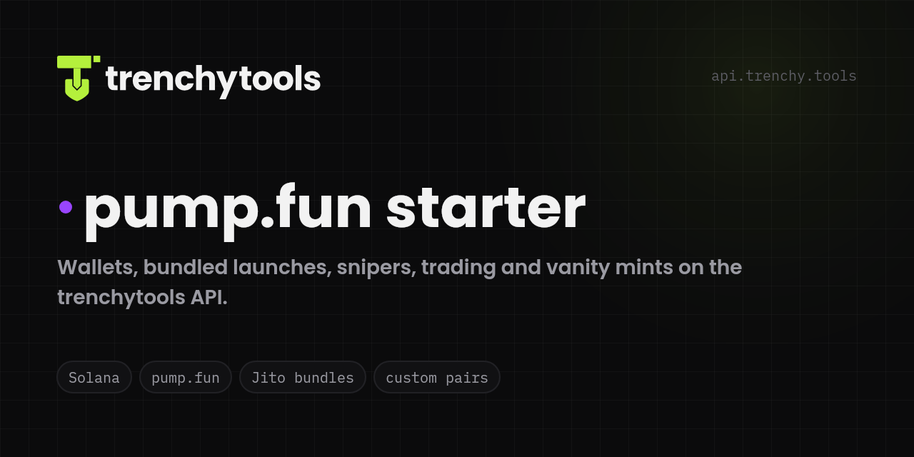
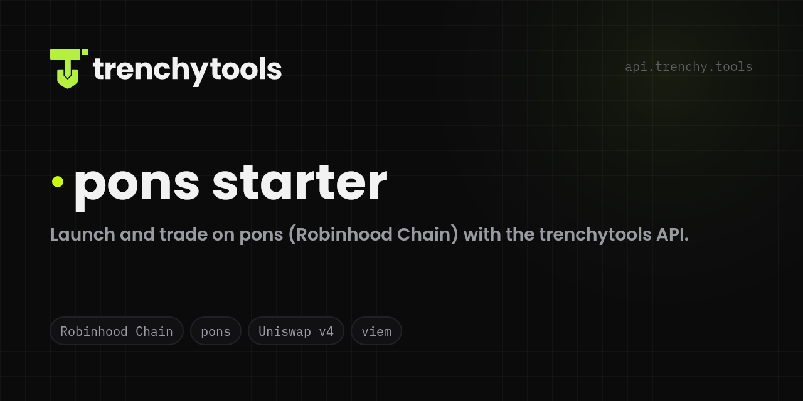
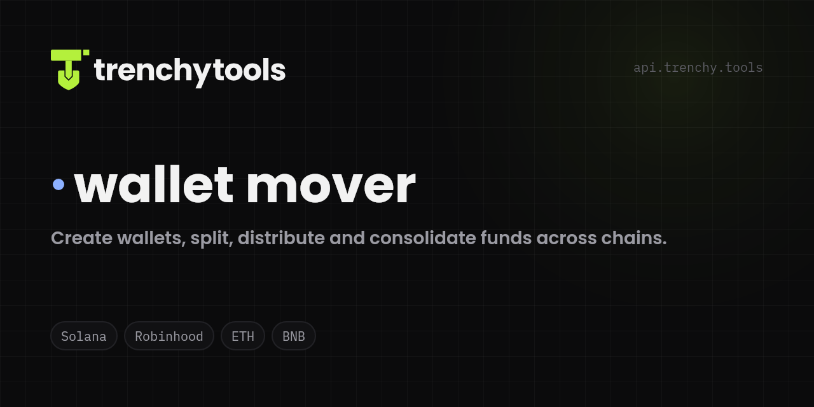

<p align="center"><a href="https://trenchy.tools"></a></p>

<p align="center">
  <a href="https://trenchy.tools/docs"></a>
  <a href="https://api.trenchy.tools/api/create-api-key?label=github"></a>
  <a href="https://api.trenchy.tools/AGENTS.md"></a>
  <a href="https://trenchy.tools/status"></a>
</p>

<p align="center">
  <a href="https://x.com/trenchytoolz"></a>
  <a href="https://t.me/trenchytools"></a>
  <a href="https://trenchy.tools/openapi.json"></a>
  <a href="https://github.com/Trenchy-Tools"></a>
</p>

## 👋 I'm SZ — I build [TrenchyTools](https://trenchy.tools)

**One API key to launch and trade memecoins.** No RPC node, no Jito client, no IPFS keys.
Launch and trade on **pump.fun** and **PumpSwap** (Solana) and **pons** (Robinhood Chain) from a single HTTP API.
The API builds unsigned transactions, your code signs locally, so keys never leave your machine. Made for humans and for AI agents.

```bash
# a key in one call, then read the agent instructions
curl "https://api.trenchy.tools/api/create-api-key?label=my-agent"
```

## 🚀 Starters — clone, paste your key, `npm run dev`

<table>
  <tr>
    <td width="33%" align="center">
      <a href="https://github.com/Trenchy-Tools/trenchytools-pumpfun-launcher"></a><br>
      <b><a href="https://github.com/Trenchy-Tools/trenchytools-pumpfun-launcher">trenchytools-pumpfun-launcher</a></b><br>
      <sub>Solana · Jito-bundled launches with up to 16 buyers, snipers, holder auto-buys, custom pairs, Mayhem mode, timed sells, vanity mints</sub><br>
      <a href="https://pumpfun.trenchy.tools">▶ live demo</a>
    </td>
    <td width="33%" align="center">
      <a href="https://github.com/Trenchy-Tools/trenchytools-pons-launcher"></a><br>
      <b><a href="https://github.com/Trenchy-Tools/trenchytools-pons-launcher">trenchytools-pons-launcher</a></b><br>
      <sub>Robinhood Chain · launch and trade on the pons curve and Uniswap v4, snipe-tax exempt buyers</sub><br>
      <a href="https://pons.trenchy.tools">▶ live demo</a>
    </td>
    <td width="33%" align="center">
      <a href="https://github.com/Trenchy-Tools/trenchytools-wallet-mover"></a><br>
      <b><a href="https://github.com/Trenchy-Tools/trenchytools-wallet-mover">trenchytools-wallet-mover</a></b><br>
      <sub>Create, fund, split and consolidate wallets across Solana, Robinhood Chain, Ethereum and BNB, direct or through an exchange</sub><br>
      <a href="https://mover.trenchy.tools">▶ live demo</a>
    </td>
  </tr>
</table>

All three share one wallet folder on your Desktop: a wallet made in one is usable in the others, and every key is written to disk before it can hold anything.

## 🧰 What the API covers

| | |
|---|---|
| 🟢 **Solana** | pump.fun create / buy / sell, custom pairs (coins priced in stocks, USDC or other coins), Mayhem mode, PumpSwap after graduation, Jito bundles, vanity mints, creator fees, live websocket |
| 🟩 **Robinhood Chain** | pons create / buy / sell on the curve and on Uniswap v4, live trades |
| 👛 **Wallets** | direct or exchange-routed transfers, same chain or cross-chain, live venue health |
| 🤖 **Agents** | `AGENTS.md`, `openapi.json`, every error with a hint and a docs link. `openclaw skills install trenchytools` |

## 🤖 Build it with AI

Paste into any coding agent:

> Read https://api.trenchy.tools/AGENTS.md and https://trenchy.tools/openapi.json, then build me a pump.fun bot that buys a coin when it launches and sells half at 2x. Save every wallet you create to a file before funding it.

<p align="center"><sub>Everything lives in the <a href="https://github.com/Trenchy-Tools">Trenchy-Tools</a> org · <a href="https://trenchy.tools">trenchy.tools</a> · <a href="https://api.trenchy.tools">api.trenchy.tools</a></sub></p>
